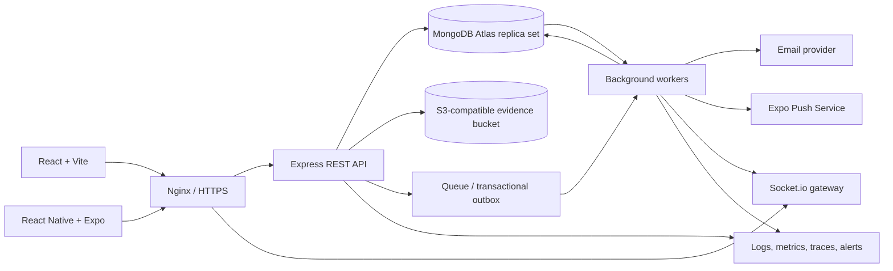
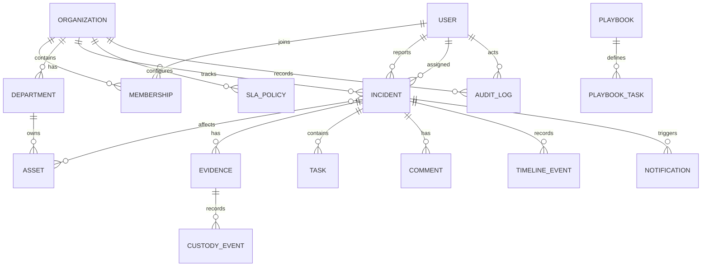

# Security Incident Response Platform: System Design

## 1. Scope and assumptions

This design describes a multi-tenant incident response platform for a React web client and React Native (Expo) mobile client backed by one REST API. Each organization is an isolation boundary. A user may belong to more than one organization, with a role assigned per organization. All timestamps are UTC; IDs in API examples are MongoDB ObjectIds serialized as strings.

The design is a production-oriented baseline, not a claim of certification. NIST SP 800-61 and ISO/IEC 27035 are used as process-alignment references; an organization must map its own controls and retention obligations before claiming compliance.

## 2. Architecture



- Express owns authentication, authorization, validation, tenant scoping, and business transitions. Socket.io is an authenticated delivery channel, not an alternate authorization path.
- Use MongoDB Atlas replica sets for transactions where a state mutation and its audit/outbox records must commit together. Keep file bytes outside MongoDB in a private S3-compatible bucket; store object keys and verified metadata in MongoDB.
- Publish notifications through an outbox written in the same transaction as the incident change. Workers deliver email, push, and socket events idempotently, then mark outbox records complete. This avoids a committed incident update with a silently lost alert.
- Use a durable queue backed by the deployment platform or a managed queue for retries, scheduled SLA checks, and report generation. Workers must be horizontally scalable and idempotent.
- Deploy API and worker containers behind Nginx or a managed HTTPS load balancer. GitHub Actions runs lint, tests, dependency/security checks, image build, and deployment with environment-specific secrets.

## 3. Roles and authorization

Every query and mutation is scoped to an organization obtained from the authenticated membership, never trusted from an arbitrary request body. Resource access additionally checks assignment, ownership, or explicit permissions where indicated.

| Role | Typical permissions |
|---|---|
| Admin | Manage organization, users, roles, policies, integrations, and all incidents; cannot alter append-only audit history. |
| SOC Manager | View/manage incidents, assign responders, set severity, manage SLAs and playbooks, review metrics. |
| Security Analyst | Triage and investigate authorized incidents; update status, tasks, comments, and response details. |
| Forensic Investigator | Access assigned investigations and authorized evidence; upload evidence and append custody events. |
| Reporter | Submit and view own reports and permitted status updates; anonymous submission does not create an account. |
| Auditor | Read-only access to explicitly permitted organizational records, audit events, and reports; no evidence download by default. |

Implement centralized RBAC middleware plus resource-level policy checks. A role does not bypass organization membership or evidence-specific access restrictions. Admins and auditors receive strong MFA enforcement; sensitive actions can require recent re-authentication.

## 4. MongoDB data model

Collections use `timestamps: true` where applicable, strict schema validation, and explicit organization references. Store references for entities with independent lifecycle, access control, or unbounded growth; embed small, bounded value objects such as scoring inputs and asset snapshots. Add `orgId` to tenant-owned records even when the record also references another tenant-owned entity, and validate reference ownership at write time.



| Collection | Key fields and validation |
|---|---|
| `users` | `email` normalized and unique; `passwordHash` only; MFA secret encrypted; `mfaEnabled`, `disabledAt`, recovery-code hashes, `lastLoginAt`. Do not store plaintext passwords or recovery codes. |
| `organizations` | `name`, unique `slug`, `settings`, `retentionPolicy`, `createdBy`. |
| `memberships` | `orgId`, `userId`, `role` enum, optional `departmentId`, `status`, `permissions` overrides (allowlist only). Unique `(orgId,userId)`. Supports multi-organization users without global roles. |
| `departments` | `orgId`, `name`, optional `parentId`; unique `(orgId,name)`. Avoid unbounded recursive population. |
| `assets` | `orgId`, `name`, `type`, `criticality` enum 1-5, `ownerDepartmentId`, `tags`, `status`, optional encrypted sensitive identifiers. |
| `incidents` | `orgId`, `incidentNumber`, `title`, `description`, `category` enum, `status` enum, `severity`, `severityScore`, `scoringInputs`, `severityOverride` (actor/time/justification), `reporterId` nullable, `anonymous`, `assignedTo`, `teamId`, `assetIds`, bounded asset snapshots, `slaPolicyId`, `slaDueAt`, `slaBreachedAt`, `detectedAt`, `occurredAt`, `closedAt`, `reopenedAt`, `lessonsLearned`, `version`. Server-generated incident number unique per organization. Validate allowed status transitions in service logic. |
| `evidence` | `orgId`, `incidentId`, `uploadedBy`, `objectKey`, `originalName` (sanitized), `contentType`, `size`, `sha256`, `scanStatus`, `classification`, `accessUserIds` / `accessRoles`, `uploadedAt`, `retentionUntil`, `deletedAt` (soft delete). Never trust client MIME type or supplied hash as verification. |
| `chainOfCustody` | Append-only `orgId`, `incidentId`, `evidenceId`, `actorId`, `action` enum, `occurredAt`, `source`, `metadata`, `previousEventHash`, `eventHash`. Restrict update/delete at DB/application level; periodically anchor signed hashes outside the primary database for stronger tamper evidence. |
| `playbooks` | `orgId` or system scope, `category`, `version`, `active`, ordered task templates, `createdBy`. Published versions are immutable; edits create a new version. |
| `tasks` | `orgId`, `incidentId`, optional `playbookId` and version, `title`, `description`, `status`, `assigneeId`, `dueAt`, `completedAt`, `completedBy`, `order`. |
| `comments` | `orgId`, `incidentId`, `authorId`, `body` (plain text or sanitized Markdown), `visibility`, optional `editedAt`; edits/deletions emit audit events. |
| `timelineEvents` | `orgId`, `incidentId`, `type`, `actorId` nullable for system events, `occurredAt`, minimal immutable event payload. No secrets or file bytes. |
| `notifications` | `orgId`, `userId`, `incidentId`, `channel`, `type`, `payload`, `readAt`, `deliveryStatus`, `dedupeKey`. Payload is minimal and must not expose sensitive incident details to push previews. |
| `auditLogs` | `orgId`, `actorId` nullable for system, `action`, `resourceType`, `resourceId`, `occurredAt`, `requestId`, `ipHash` or approved network metadata, `changes` allowlist, `prevHash`, `eventHash`. Application is append-only; restrict DB credentials and export to immutable/WORM storage for higher assurance. |
| `slaPolicies` | `orgId`, `name`, `active`, severity/category conditions, response and resolution targets, business calendar/time zone, escalation rules, version. Changes apply prospectively unless explicitly migrated. |
| `outboxEvents` | `orgId`, `eventType`, `aggregateId`, `payload`, `createdAt`, `availableAt`, `attempts`, `processedAt`, `dedupeKey`. Internal delivery mechanism; redact sensitive payloads. |
| `sessions` | `userId`, `orgId`, hashed refresh-token family identifier, `expiresAt`, `revokedAt`, device metadata. TTL cleanup is housekeeping, not the authorization check. |

### Sample documents

```javascript
// incidents
{
  _id: ObjectId("66a100000000000000000001"),
  orgId: ObjectId("66a100000000000000000010"),
  incidentNumber: "IR-2026-0042",
  title: "Suspicious invoice attachment",
  description: "Employee reported an unexpected attachment; endpoint isolated.",
  category: "phishing",
  status: "Triaged",
  severity: "High",
  severityScore: 72,
  scoringInputs: { impact: 4, urgency: 5, assetCriticality: 4 },
  severityOverride: null,
  reporterId: ObjectId("66a100000000000000000020"),
  anonymous: false,
  assignedTo: ObjectId("66a100000000000000000021"),
  assetIds: [ObjectId("66a100000000000000000030")],
  slaPolicyId: ObjectId("66a100000000000000000040"),
  slaDueAt: ISODate("2026-09-29T18:00:00Z"),
  detectedAt: ISODate("2026-09-29T14:00:00Z"),
  version: 3,
  createdAt: ISODate("2026-09-29T14:08:00Z"),
  updatedAt: ISODate("2026-09-29T14:20:00Z")
}

// evidence metadata (bytes live in private object storage)
{
  _id: ObjectId("66a100000000000000000050"),
  orgId: ObjectId("66a100000000000000000010"),
  incidentId: ObjectId("66a100000000000000000001"),
  uploadedBy: ObjectId("66a100000000000000000021"),
  objectKey: "org/66a1/incidents/66a1/evidence/66a1",
  originalName: "message.eml",
  contentType: "message/rfc822",
  size: 48120,
  sha256: "<64 lowercase hex characters computed by server>",
  scanStatus: "clean",
  classification: "confidential",
  uploadedAt: ISODate("2026-09-29T14:23:00Z"),
  retentionUntil: ISODate("2033-09-29T00:00:00Z")
}

// chainOfCustody (each event is a new document)
{
  _id: ObjectId("66a100000000000000000060"),
  orgId: ObjectId("66a100000000000000000010"),
  incidentId: ObjectId("66a100000000000000000001"),
  evidenceId: ObjectId("66a100000000000000000050"),
  actorId: ObjectId("66a100000000000000000021"),
  action: "uploaded",
  occurredAt: ISODate("2026-09-29T14:23:00Z"),
  previousEventHash: null,
  eventHash: "<server-computed hash over canonical event and previous hash>"
}

// memberships
{
  orgId: ObjectId("66a100000000000000000010"),
  userId: ObjectId("66a100000000000000000021"),
  role: "Security Analyst",
  status: "active",
  departmentId: ObjectId("66a100000000000000000070")
}
```

### Index strategy

Create indexes in migrations and verify them against production query shapes. Prefix tenant-scoped indexes with `orgId`; apply indexes selectively because every additional index increases write cost.

| Collection | Index |
|---|---|
| `users` | Unique `{ email: 1 }` (normalized). |
| `memberships` | Unique `{ orgId: 1, userId: 1 }`; `{ userId: 1, status: 1 }`. |
| `incidents` | Unique `{ orgId: 1, incidentNumber: 1 }`; `{ orgId: 1, status: 1, severity: 1, createdAt: -1 }`; `{ orgId: 1, assignedTo: 1, status: 1, updatedAt: -1 }`; `{ orgId: 1, createdAt: -1 }`; `{ orgId: 1, category: 1, createdAt: -1 }`; `{ orgId: 1, slaDueAt: 1, status: 1 }`. |
| `assets` | Unique `{ orgId: 1, normalizedName: 1 }` when names are unique; `{ orgId: 1, criticality: -1, status: 1 }`. |
| `evidence` | `{ orgId: 1, incidentId: 1, uploadedAt: -1 }`; unique `{ orgId: 1, objectKey: 1 }`. |
| `chainOfCustody` | `{ orgId: 1, evidenceId: 1, occurredAt: 1, _id: 1 }`; unique `{ orgId: 1, eventHash: 1 }` where supported by the chosen hash scheme. |
| `tasks` | `{ orgId: 1, incidentId: 1, status: 1, order: 1 }`; `{ orgId: 1, assigneeId: 1, status: 1, dueAt: 1 }`. |
| `comments`, `timelineEvents` | `{ orgId: 1, incidentId: 1, createdAt: -1, _id: -1 }` / `{ orgId: 1, incidentId: 1, occurredAt: -1, _id: -1 }`. |
| `notifications` | `{ orgId: 1, userId: 1, readAt: 1, createdAt: -1 }`; unique `{ dedupeKey: 1 }` for idempotency. |
| `auditLogs` | `{ orgId: 1, resourceType: 1, resourceId: 1, occurredAt: -1 }`; `{ orgId: 1, actorId: 1, occurredAt: -1 }`. Archive by retention policy; do not TTL-delete records required for legal or compliance retention. |
| `outboxEvents` | `{ processedAt: 1, availableAt: 1 }`; unique `{ dedupeKey: 1 }`. |
| `sessions` | `{ expiresAt: 1 }` TTL plus `{ userId: 1, revokedAt: 1 }`. Validate expiration in application code regardless of TTL delay. |

Use Atlas Search for relevance-ranked full-text search where available; otherwise use bounded text indexes with tenant filters. Avoid regex scans on user-controlled input. Paginate large lists with opaque cursor pagination ordered by `(createdAt, _id)`; cap page size at 100 and validate sort fields against an allowlist.

## 5. Severity and incident workflow

### Severity scoring

A configurable starting matrix is `score = impact (1-5) × urgency (1-5) × asset criticality (1-5)`, yielding 1-125. Example bands: Low 1-20, Medium 21-45, High 46-80, Critical 81-125. Tune bands through incident exercises and store the matrix version with each incident. Asset criticality defaults to 1 only when no asset is known; the API returns the inputs and suggested level so responders can correct them. A manual override requires a non-empty justification and records actor, time, previous value, and new value in the audit log. Never silently overwrite the override during recalculation.

### State machine

`New -> Triaged -> Assigned -> Investigating -> Contained -> Eradicated -> Recovered -> Closed`; `Closed -> Reopened -> Triaged` is allowed. Define explicit permitted transitions, required fields, and role permissions in service logic. For example, closure requires a resolution summary and completed required tasks; reopening requires a reason. Keep `status` separate from severity. Every transition atomically updates the incident version, appends a timeline/audit event, and emits an outbox event. Use optimistic concurrency with `version` / `If-Match` to prevent lost updates.

SLA timers are calculated from a versioned policy and business calendar, with separate response and resolution deadlines. A scheduled worker emits one breach event per deadline and escalates by configured role/team. The UI should display remaining time from server due dates; clients do not decide whether an SLA is breached.

## 6. REST API conventions

Base path: `/api/v1`. Require HTTPS and `Authorization: Bearer <access-token>` except public registration/login/reset/report endpoints. JSON uses camelCase. Successful responses use the resource or page envelope below. Mutations that can be retried support an `Idempotency-Key`; state-changing incident requests may require `If-Match`.

List query convention: `?limit=25&cursor=<opaque>&sort=-createdAt&status=Investigating&severity=High&category=phishing&assignedTo=<id>&q=invoice&from=2026-09-01T00:00:00Z&to=2026-10-01T00:00:00Z`. Unsupported filters and sort keys return `400`. Search and all filtering are organization-scoped.

```json
{
  "data": [{ "id": "66a100000000000000000001", "incidentNumber": "IR-2026-0042", "status": "Triaged", "severity": "High" }],
  "page": { "nextCursor": "eyJjcmVhdGVkQXQiOi...", "hasMore": true },
  "requestId": "req_01J..."
}
```

Common errors: `400 VALIDATION_ERROR`, `401 UNAUTHENTICATED`, `403 FORBIDDEN`, `404 NOT_FOUND` (also used for inaccessible tenant resources to limit enumeration), `409 CONFLICT` / `VERSION_CONFLICT`, `413 FILE_TOO_LARGE`, `415 UNSUPPORTED_MEDIA_TYPE`, `422 INVALID_TRANSITION`, `429 RATE_LIMITED`, `500 INTERNAL_ERROR`, `503 DEPENDENCY_UNAVAILABLE`. Error body: `{"error":{"code":"VALIDATION_ERROR","message":"Request validation failed","details":[{"field":"title","issue":"required"}]},"requestId":"req_01J..."}`. Never return stack traces or secrets.

### Authentication and sessions

| Method and path | Access | Purpose |
|---|---|---|
| `POST /auth/register` | Public; invite/organization policy | Create account or accept invite. |
| `POST /auth/login` | Public, rate-limited | Verify password and MFA challenge; issue short-lived access and rotating refresh tokens. |
| `POST /auth/refresh` | Refresh token | Rotate token family; reuse revokes the family. |
| `POST /auth/logout` | Authenticated | Revoke current refresh session. |
| `POST /auth/logout-all` | Authenticated, recent MFA | Revoke all user sessions. |
| `POST /auth/mfa/enroll` | Authenticated, recent auth | Begin TOTP enrollment. |
| `POST /auth/mfa/verify` | Authenticated / challenge | Verify TOTP and activate enrollment. |
| `DELETE /auth/mfa` | Authenticated, recent MFA | Disable TOTP and audit the action. |
| `POST /auth/password/forgot` | Public, rate-limited | Send a single-use reset flow without account enumeration. |
| `POST /auth/password/reset` | Reset token | Set a new password and revoke sessions. |
| `GET /auth/me` | Authenticated | Return profile and active organization memberships. |
| `GET /auth/sessions` | Authenticated | List own active sessions. |
| `DELETE /auth/sessions/:sessionId` | Authenticated | Revoke own session. |

Login request/response (MFA challenge may be returned instead of tokens):

```json
// POST /api/v1/auth/login
{ "email": "analyst@example.org", "password": "<sent over TLS>", "totpCode": "123456", "orgSlug": "example-org" }
// 200
{ "data": { "accessToken": "<short-lived>", "expiresIn": 900, "refreshToken": "<rotated; secure cookie recommended>", "user": { "id": "...", "memberships": [{ "orgId": "...", "role": "Security Analyst" }] } } }
```

Prefer refresh tokens in `HttpOnly`, `Secure`, `SameSite` cookies for the browser and platform-secure storage in Expo; protect cookie-based refresh endpoints against CSRF. Hash refresh tokens in storage. JWT claims should be minimal (`sub`, session ID, issue/expiry); re-check membership/disablement for sensitive operations and use short access-token lifetimes.

### Organization and access administration

| Method and path | Access | Purpose |
|---|---|---|
| `GET /organizations/:orgId` | Org member | Read organization settings. |
| `PATCH /organizations/:orgId` | Admin | Update settings and retention configuration. |
| `GET /organizations/:orgId/members` | Admin, SOC Manager (read) | List members with cursor filters. |
| `POST /organizations/:orgId/invitations` | Admin | Invite member with role. |
| `PATCH /organizations/:orgId/members/:userId` | Admin | Change role/status/department; audit and revoke stale sessions as needed. |
| `DELETE /organizations/:orgId/members/:userId` | Admin | Remove membership (not global user). |
| `GET/POST /organizations/:orgId/departments` | Member read / Admin write | List or create departments. |
| `GET/POST /organizations/:orgId/assets` | Member read / Admin, SOC Manager write | List or register assets. |
| `GET/PATCH/DELETE /organizations/:orgId/assets/:assetId` | Member read / Admin, SOC Manager write | Read/update/archive asset. |

### Incidents, workflow, and response

| Method and path | Access | Purpose |
|---|---|---|
| `POST /incidents` | Member; public anonymous route separately | Report incident; server computes severity suggestion and SLA. |
| `GET /incidents` | Member | Search/filter incidents visible to role. |
| `GET /incidents/:incidentId` | Authorized member | Read incident and allowed related summaries. |
| `PATCH /incidents/:incidentId` | Reporter (own limited fields), Analyst, SOC Manager, Admin | Update editable fields with version check. |
| `POST /incidents/:incidentId/triage` | Analyst, SOC Manager, Admin | Record triage, category, score inputs and suggested severity. |
| `POST /incidents/:incidentId/severity-override` | SOC Manager, Admin | Override severity with mandatory justification. |
| `POST /incidents/:incidentId/assign` | SOC Manager, Admin | Assign user/team and optionally set priority. |
| `POST /incidents/:incidentId/transitions` | Analyst, SOC Manager, Admin | Request validated status transition. |
| `POST /incidents/:incidentId/reopen` | Analyst, SOC Manager, Admin | Reopen closed incident with reason. |
| `GET /incidents/:incidentId/timeline` | Authorized member | Cursor-paginated timeline. |
| `GET/POST /incidents/:incidentId/comments` | Authorized member | List/add comments, with visibility checks. |
| `GET/POST /incidents/:incidentId/tasks` | Analyst, SOC Manager, Admin | List/add response checklist items. |
| `PATCH /incidents/:incidentId/tasks/:taskId` | Assignee, Analyst, SOC Manager, Admin | Update task state/assignee/due date. |
| `GET/POST /playbooks` | Member read / SOC Manager, Admin write | List or version/create playbooks. |
| `GET/POST /organizations/:orgId/sla-policies` | SOC Manager read/write; Admin manage | List and version SLA policies. |

Incident creation example:

```json
// POST /api/v1/incidents
{ "title": "Suspicious invoice attachment", "description": "Unexpected email attachment", "category": "phishing", "assetIds": ["66a100000000000000000030"], "occurredAt": "2026-09-29T13:55:00Z" }
// 201
{ "data": { "id": "66a100000000000000000001", "incidentNumber": "IR-2026-0042", "status": "New", "severity": "High", "severityScore": 72, "scoringInputs": { "impact": 4, "urgency": 5, "assetCriticality": 4 }, "slaDueAt": "2026-09-29T18:00:00Z", "version": 1 }, "requestId": "req_01J..." }
```

Anonymous reporting is a distinct public endpoint, e.g. `POST /public/report/:publicFormToken`; token scope, CAPTCHA/bot mitigation, payload limits, and per-IP rate limits apply. Do not expose a reporter identity in response data. Anonymous reports receive a high-entropy follow-up token whose hash is stored; do not log the raw token or IP address unless policy explicitly requires it.

Transition example: `POST /api/v1/incidents/:id/transitions` with `If-Match: "3"` and `{"to":"Contained","reason":"Endpoint isolated"}`. Return `409 VERSION_CONFLICT` for a stale version and `422 INVALID_TRANSITION` when the transition or required fields are invalid.

### Evidence and custody

| Method and path | Access | Purpose |
|---|---|---|
| `POST /incidents/:incidentId/evidence/upload-url` | Investigator, Analyst, SOC Manager | Create a short-lived, scoped upload URL after metadata validation. |
| `POST /incidents/:incidentId/evidence/:evidenceId/complete` | Uploader, Investigator, Analyst | Verify object exists, stream/hash and scan it, then register evidence and custody event. |
| `GET /incidents/:incidentId/evidence` | Authorized evidence viewers | List metadata only. |
| `GET /evidence/:evidenceId/download-url` | Explicit evidence permission | Issue short-lived download URL after access check. |
| `GET /evidence/:evidenceId/custody` | Investigator, SOC Manager, Auditor | Read append-only custody history (auditor metadata only as policy dictates). |
| `POST /evidence/:evidenceId/custody-events` | Investigator, Admin | Append permitted custody action with reason. |
| `DELETE /evidence/:evidenceId` | SOC Manager, Admin | Soft-delete/quarantine subject to retention/legal hold; audit reason required. |

Upload init example: `POST /incidents/:id/evidence/upload-url` with `{ "fileName":"message.eml", "contentType":"message/rfc822", "size":48120 }`; response returns evidence ID, one-time upload URL, required headers, and expiration. The client uploads directly to private quarantine storage. Completion is not trusted until server-side size, extension/signature, malware scan, SHA-256, ownership, and object-key checks succeed. Disallow executable content by default, enforce per-file and per-incident quotas, and never serve uploaded files inline from the application origin.

### Notifications, analytics, reports, and audit

| Method and path | Access | Purpose |
|---|---|---|
| `GET /notifications` | Authenticated | List own notifications with cursor/unread filter. |
| `PATCH /notifications/:id/read` | Recipient | Mark own notification read. |
| `POST /notifications/read-all` | Authenticated | Mark own notifications read. |
| `GET /analytics/overview` | SOC Manager, Admin, Auditor | Counts by severity/status/category and SLA compliance for a date range. |
| `GET /analytics/trends` | SOC Manager, Admin, Auditor | Monthly volume and MTTD/MTTR aggregates. |
| `GET /analytics/workload` | SOC Manager, Admin | Active workload by analyst/team. |
| `POST /reports` | SOC Manager, Admin, Auditor | Queue PDF/CSV export with scoped filters. |
| `GET /reports/:reportId` | Requester / authorized role | Check generation status and retrieve metadata. |
| `GET /reports/:reportId/download` | Requester / authorized role | Short-lived signed download after fresh authorization. |
| `GET /audit-logs` | Admin, Auditor | Search immutable audit metadata by actor/resource/date. |
| `GET /incidents/:incidentId/audit-logs` | Admin, Auditor | Read incident-related audit events. |
| `GET/PATCH /organizations/:orgId/retention-policy` | Admin read/write; Auditor read | Read/update retention and legal hold settings. |

Analytics use server-side aggregation scoped by tenant and permissions. Define MTTD as `detectedAt - occurredAt` where both timestamps are known; define MTTR explicitly (recommended: `closedAt - detectedAt`, with reopened incidents reported separately). Exclude or separately report missing timestamps and paused/business-hours SLA time. Exports are asynchronous, access logged, watermarked where appropriate, and expire according to policy.

## 7. Real-time events

Authenticate Socket.io during handshake with the same access-token verification. Join rooms only after checking current organization membership and resource permissions. Use server-controlled rooms such as `org:<id>` and `incident:<id>`; never allow clients to join arbitrary room names. Emit minimal events (`incident.updated`, `incident.assigned`, `sla.breached`, `notification.created`) with resource IDs and version, then have clients fetch authorized details over REST. Re-check authorization on reconnect and do not treat socket delivery as durable; clients reconcile using REST and event cursors.

## 8. Security and privacy controls

- **Transport and headers:** TLS end-to-end; Helmet with a deliberate Content Security Policy; HSTS at the trusted edge; secure cookies; disable unnecessary Express headers. CORS allowlists known web origins and required methods/headers, never wildcard credentials.
- **Authentication:** bcrypt or Argon2id password hashing with calibrated cost; breached-password checks where feasible; TOTP MFA with encrypted secrets and hashed one-time recovery codes; short-lived access JWTs; rotating, hashed refresh tokens; reset links single-use, expiring, and non-enumerating.
- **Authorization:** Default deny; tenant scope in every repository/service query; validate ownership for every referenced asset, user, incident, and evidence object; resource-level evidence checks; least-privilege service and database accounts.
- **Input/output:** Joi or Zod schemas at all boundaries; allowlisted sort/filter fields; bounded strings/arrays; reject MongoDB operators in user keys and construct queries from validated values; escape or sanitize rendered Markdown/HTML; React must render untrusted text as text. Use CSRF protection for cookie-authenticated state changes.
- **Abuse resistance:** Per-IP and per-account rate limits, stricter limits on login/reset/public reporting/upload-url routes, bot controls for public forms, request/body size limits, upload quotas, and idempotency keys. Avoid revealing whether a user, incident, or tenant exists.
- **Evidence:** Private bucket, server-generated object keys, short-lived presigned URLs, quarantine and malware scanning, extension/MIME/signature checks, SHA-256 computed from bytes, encryption at rest, least-privilege KMS, access logging, and retention/legal hold enforcement. Never accept a client hash as proof of integrity.
- **Sensitive data:** Use TLS and managed encryption at rest. Encrypt selected high-sensitivity fields with envelope encryption and managed key rotation; do not place secrets, passwords, tokens, evidence contents, or full incident descriptions in logs/analytics. Define key access and rotation procedures.
- **Audit integrity:** Append-only application API, restrictive DB roles, separate audit export credentials, hash chaining, periodic signed external anchoring or WORM storage, monitored gaps, and tested restore/export procedures. Hash chaining alone is not immutable if the same administrator can rewrite the entire chain.
- **Operations:** Secret manager, dependency/container scanning, patch process, backups with point-in-time recovery, tested disaster recovery, incident response plan, and redacted structured logs with correlation/request IDs.

### OWASP Top 10 checklist

| Risk | Controls |
|---|---|
| Broken access control | Tenant scoping, centralized RBAC, object-level checks, deny-by-default tests. |
| Cryptographic failures | TLS, managed encryption, field encryption, bcrypt/Argon2id, key rotation, no secrets in logs. |
| Injection | Joi/Zod validation, constructed Mongo queries, no untrusted operators, parameterized external queries. |
| Insecure design | Threat modeling, abuse cases, separation of duties, safe state machine and upload workflow. |
| Security misconfiguration | Helmet/CSP, strict CORS, hardened containers, private storage, environment-specific config. |
| Vulnerable components | Lockfiles, automated dependency/container scanning, patch SLAs, SBOM. |
| Authentication failures | MFA, rate limits, token rotation/revocation, secure reset and session management. |
| Software/data integrity failures | CI protections, signed/reviewed builds, pinned dependencies, outbox idempotency, evidence hash verification. |
| Logging/monitoring failures | Structured redacted audit/security logs, alerting, traceable request IDs, retention and access reviews. |
| SSRF | Restrict outbound destinations, block metadata/private network access, validate webhook/import URLs, egress controls. |

## 9. Mobile, accessibility, and user experience

The Expo app uses the same API and authorization rules. Store refresh credentials in iOS Keychain/Android Keystore-backed secure storage, never AsyncStorage; support biometric unlock as a local convenience, not an API authorization substitute. Use Expo Notifications with minimal lock-screen content and deep links that re-fetch authorization. Camera and file imports use the same upload-url, quarantine, scanning, and custody workflow as web. Queue drafts safely offline, but clearly distinguish unsubmitted reports from server-accepted reports.

Web UI uses React, Vite, Redux Toolkit or Zustand (choose one based on team familiarity), Tailwind, and Recharts. Keep server state cache invalidation/version reconciliation explicit. Provide keyboard access, visible focus, semantic labels, sufficient contrast, non-color severity indicators, reduced-motion support, accessible charts with tabular alternatives, and WCAG 2.2 AA testing. Test responsive layouts at mobile widths and keep core report/triage flows usable without hover.

## 10. Reliability, scale, and operations

- **10,000+ users:** Stateless API replicas; indexes matched to tenant query patterns; cursor pagination; background workers for exports, notification delivery, malware scans, and SLA checks; bounded socket fanout; Atlas capacity/load testing; cache only derived, permission-safe data.
- **99.5% availability:** This allows about 3.6 hours of downtime per 30-day month. Define service-level indicators for API availability/latency, queue lag, DB health, and notification delay; alert on error budgets. Deploy across availability zones where available, use readiness/liveness checks, rolling deploys, backups, and documented recovery objectives. Availability target depends on selected hosting/database tiers and must be validated operationally.
- **Performance:** Target p95 API latency and page-load budgets explicitly; keep initial dashboard queries bounded and aggregates precomputed where measured need justifies it. Verify the requested <3s page load with production-like data and realistic mobile network profiles; do not promise it from design alone.
- **Observability:** Structured JSON logs, metrics, distributed traces, dashboards, and alerting; correlate API, worker, and socket events with request/trace IDs. Monitor auth failures, authorization denials, upload scans, SLA breaches, outbox backlog, queue retries, DB pool saturation, and storage costs. Redact PII and restrict log access.
- **Testing:** Jest/Supertest API unit and integration tests; replica-set integration tests for transactions; authorization matrix and tenant-isolation tests; React Testing Library for web; mobile flow tests; contract tests; upload security tests; load and failure-injection tests; Postman collection for manual/API smoke checks. CI should gate migrations, lint/typecheck, tests, dependency scan, and container scan.

## 11. Delivery sequence

1. Foundation: organization membership, authentication/MFA, audit/outbox, tenant-scoped API conventions, CI, and infrastructure secrets.
2. Incident loop: reporting, scoring, lifecycle, assignment, SLA worker, comments, timeline, and core dashboard.
3. Evidence: private storage, upload quarantine/scan/hash, custody chain, access controls, retention, and export.
4. Notifications and clients: web/mobile workflows, socket updates, email/push delivery, accessibility, and offline-safe drafts.
5. Hardening: load/recovery exercises, external audit anchoring, compliance mapping, threat-model review, and production SLO validation.
